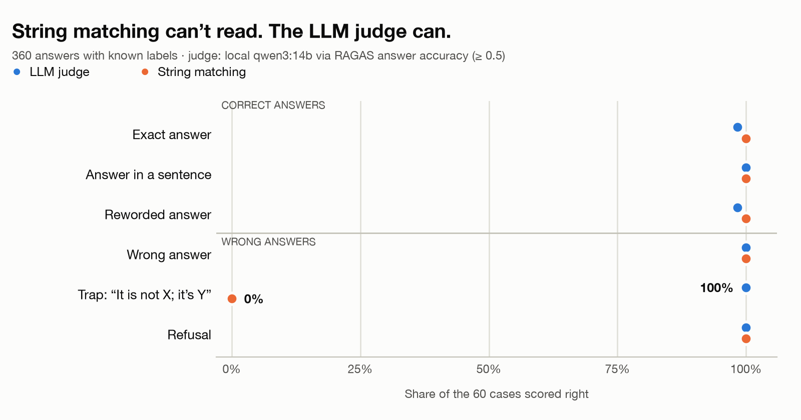
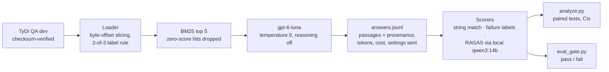

# rag-evaluation-llm-judge

[](https://github.com/regankight/rag-evaluation-llm-judge/actions/workflows/tests.yml)

**Checks whether a RAG evaluation can be trusted, then uses it to measure a prompt fix.**

- **Result:** one prompt line cut answers to unanswerable questions from **58% to 24%**, and unsupported answers from **24% to 8%**.
- **Why it matters:** fewer confident wrong answers, with the cost measured too, plus a CI gate that blocks changes that make things worse.
- **Stack:** Python · RAG · LLM evaluation · LLM-as-a-judge (RAGAS) · OpenAI · Ollama · BM25 · pytest · GitHub Actions

<picture>
  <source media="(prefers-color-scheme: dark)" srcset="docs/img/known-truth-dark.png">
  
</picture>

## Three findings

1. **String matching can't read.** It accepted all 60 trap answers of the form *"It is not X; the answer is Y"* as correct, because the gold words appear; the LLM judge rejected all 60. On 200 real answers, string matching rejected 33 that the judge accepted, mostly paraphrases ("1782 to 1840" vs gold "27 October 1782–27 May 1840").
2. **One prompt line cut answers to unanswerable questions from 58% to 24%.** On 50 questions TyDi QA marks unanswerable, telling the model to reply `NOT_IN_CONTEXT` when the passages lack the answer fixed 17 and broke none (exact McNemar p = 0.000015; refusals labeled by a human). Not every such answer is made up: a blind labelling pass against the retrieved passages found that of v1's 29, 10 were supported by a passage, 7 refused and then added a related fact, and 12 were **unsupported** (a misreading, or a fact in no passage). Unsupported answers fell from 12/50 to 4/50 (fixed 9, broke 1, exact McNemar p = 0.021; [report](reports/grounding.md)). The cost: answering less from memory where retrieval missed (accuracy −0.11 there, −0.004 where retrieval worked). The overall accuracy change, −0.048, isn't statistically established.
3. **The judge needs testing too.** Settings were silently not applied twice: Ollama truncated long judge prompts, and RAGAS rewrote `temperature` 0 → 1.0 for models named `gpt-5` and up. The obvious RAGAS correctness metric scored correct answers 0 on this data. RAGAS faithfulness scored 13 of the 16 answers a human found unsupported as faithful (≥ 0.5). About 5% of the dataset's own answer key was wrong. Every one was caught by checking what actually happened, not what the configuration said.

## Quick start

```bash
git clone https://github.com/regankight/rag-evaluation-llm-judge && cd rag-evaluation-llm-judge
make reproduce   # tests, lint, regression-gate demo, regenerate every reported number (offline; seconds once installed)
```

Needs [uv](https://docs.astral.sh/uv/) and Python 3.12. No API key, model or dataset download is required to reproduce the results: every run's answers and scores are committed. To re-run the pipeline itself, see [Reproduce from scratch](#reproduce-from-scratch).

**Why `make reproduce` shows different refusal numbers from the headline.** The regression gate prints answered-unanswerable 26/50 → 12/50 (p = 0.00052) and over-refusal 1/52 → 2/52. The headline figures (29/50 → 12/50, p = 0.000015; over-refusal 0/52 → 2/52) use the 150 human refusal labels. A CI gate can't wait for humans, so it detects v1's free-text refusals with a pattern, and that pattern disagrees with the human labels on a handful of hedged answers. Both sets are correct for what they count; published rates use the human labels. Details: [decision 0011](docs/decisions/0011-regression-gate.md).

## For a product owner

- **Don't trust a single RAG score.** The cheap metric (string matching) and the expensive one (an LLM judge) disagreed on 39 of 200 real answers. Which one you believe moves the measured accuracy by 12–15 points (string matching 47% vs judge 59% for the baseline prompt).
- **"Fewer hallucinations" is a trade-off, not a free win.** The grounded prompt answered unanswerable questions far less often (58% → 24%; unsupported answers 24% → 8%) but also stopped answering from general knowledge when search missed. Decide which behavior your users need: a system that says "I don't know", or one that's sometimes right for the wrong reason.
- **Evaluate on every change, automatically.** The regression gate here would have blocked reverting to the old prompt (answers to unanswerable questions back up, with strong evidence), and lets the new one through with a warning for a human to review.
- **Budget:** generating answers cost under 1 cent per 100 questions. A local judge costs nothing per call but took ~100 minutes per 100 answers for three metrics on a laptop; an API judge did 360 checks in 5.5 minutes for 5.5 cents.

## When to use which scorer

| Scorer | Use it for | Don't use it for | Evidence here |
|---|---|---|---|
| **String matching** | Short exact answers (names, dates, IDs); instant, free regression checks in CI | Paraphrases; negation; long answers | Failed 60/60 negation traps; rejected 33 real answers the judge accepted |
| **LLM judge (RAGAS answer accuracy)** | Correctness when wording varies | Anything you haven't tested it on first | 356/358 on clean known-truth cases (local), 358/358 (API) |
| **LLM judge (faithfulness)** | "Did the answer stick to the passages?" | Telling a refusal from a correct answer | v1's free-text refusals all scored "faithful"; 69/71 `NOT_IN_CONTEXT` refusals came back blank |
| **Humans** | Definitions a metric can't settle (what counts as a refusal) | Open-domain correctness without domain knowledge | 150 refusal labels; the automatic pattern disagreed on 16 |
| **Known-truth cases** | Testing any scorer before trusting it | Measuring how often failures happen in real traffic | Found both judges' real weaknesses (wording sensitivity, bad answer keys) |

## What's in here



Every retrieved passage carries its article title, URL, passage index and byte range from the loader through to the scored record, so any answer can be traced to the exact text the model saw.

| | |
|---|---|
| Dataset | [TyDi QA](https://github.com/google-research-datasets/tydiqa) primary task, English dev split: 456 answerable + 284 unanswerable questions after labeling rules; frozen samples of 30 (dev, for tuning) and 150 (held-out: 100 answerable + 50 unanswerable) |
| Generator | OpenAI `gpt-6-luna`, `temperature 0`, `reasoning_effort "none"` |
| Judge | `qwen3:14b` via Ollama with a pinned 8k context window; `gpt-6-luna` as a second judge on known-truth cases only (it wrote the real answers, so it can't judge them) |
| Metrics | String match; retrieval-vs-generation failure labels; RAGAS faithfulness, context recall, answer accuracy |
| Prompts | v1 baseline; v2 adds "reply with exactly NOT_IN_CONTEXT…" (predictions written before it ran) |

## Results

Full report: [`reports/analysis.md`](reports/analysis.md), regenerated by `make reproduce`.

**The prompt change, against predictions written before it ran** ([decision 0007](docs/decisions/0007-prediction-not-in-context-prompt.md)):

| | v1 | v2 | Predicted size held? | Direction held? |
|---|---|---|---|---|
| Answered an unanswerable question (n=50) | 58% | 24% | No (baseline was worse than predicted) | **Yes**, p = 0.000015 |
| ↳ of which unsupported by the passages (blind human labels, n=50) | 24% | 8% | Not predicted (added later) | **Yes**, p = 0.021 |
| Refused although the answer was retrieved (n=52) | 0% | 3.8% | No (smaller cost than feared) | Yes |
| Answered although the gold passage wasn't retrieved (n=48) | 79% | 35% | No (near miss) | Yes |
| Mean answer accuracy (n=100) | 0.54 | 0.49 | Point estimate in range | **Not established** (95% CI −0.100 to +0.003) |
| Refusals scored blank by faithfulness | 0/31 | 69/71 | Yes | Yes |

**How many questions you need:** with this spread of scores, the 95% interval on mean accuracy is about ±0.28 at 10 questions, ±0.12 at 50 and ±0.09 at 100.

**Does the judge threshold matter?** At ≥ 0.5 / ≥ 0.75 / 1.0, v1 accuracy reads 59% / 49% / 42%, but the v1 − v2 gap stays 3–4 points at every threshold. Absolute numbers depend on the threshold; the comparison doesn't.

## What went wrong, and how it was caught

| What happened | How it was caught | Record |
|---|---|---|
| Ollama loaded the judge with a 4k context and **silently truncated** longer prompts (the reported token count even shrank) | Scoring was suspiciously slow; prompts of known length came back short; the server log had the only trace | [0005](docs/decisions/0005-judge-context-window.md) |
| **RAGAS rewrote `temperature` 0 → 1.0** for any model named `gpt-5`…`gpt-19` | The request body is recorded as sent, not as configured | [0010](docs/decisions/0010-api-judge-vs-local-judge.md) |
| RAGAS **factual correctness scored correct answers 0**: its claim-splitting dropped the key fact | Printed the intermediate claims for an obviously correct answer | [0006](docs/decisions/0006-answer-accuracy-over-factual-correctness.md) |
| **Wrong answers in the dataset's answer key** (e.g. "1868" as the answer to a *where* question) | The judge "failed" on them, twice, independently | [0002](docs/decisions/0002-judge-qwen3-14b-spike.md), [0008](docs/decisions/0008-known-truth-tests-replace-correctness-review.md) |
| My own **miscount of answerable questions** (597 instead of 524) | Re-derived the count from the written rule before freezing samples | [0003](docs/decisions/0003-labels-and-samples.md) |
| Prompt v2's first wording produced free-text refusals instead of the marker | Dev run; fixed once, for format only, as declared in advance, then frozen | [0007](docs/decisions/0007-prediction-not-in-context-prompt.md) |
| A blind human review of answer *correctness* wasn't workable: open-domain trivia needs domain knowledge a reviewer doesn't have | Stopped and replaced with known-truth tests; humans kept for what they judge reliably (refusals) | [0008](docs/decisions/0008-known-truth-tests-replace-correctness-review.md) |
| Ten issues in a pre-publication code review (e.g. the gate crashing on blank scores, decimals matching integers) | Each reproduced before fixing; nine fixed, one found not to be an issue | [0012](docs/decisions/0012-code-review-fixes.md) |
| The headline measure was called **"made-up answers"**, but 10 of v1's 29 were supported by a retrieved passage | A blind labelling pass of every such answer against its passages; measure renamed, unsupported answers reported separately | [0013](docs/decisions/0013-grounding-labels.md) |

## How I'd roll this out at a client

- **Build a gold set with subject-matter experts** (50–100 questions from real traffic). Wikipedia trivia stood in here; a client's documents need people who know them.
- **Make refusals explicit.** Have the prompt emit a marker like `NOT_IN_CONTEXT` so refusals can be counted exactly. Automatic detection of free-text refusals counted 26 answers to unanswerable questions where a human counted 29.
- **Test the judge before trusting it,** with known-truth cases in the client's own answer style, and re-test when the judge model or framework version changes.
- **Choose the judge's hosting by data and volume.** A local model (here `qwen3:14b`) keeps data on the client's network and costs nothing per call. A hosted model, via the client's existing OpenAI, Azure OpenAI or AWS Bedrock account, is faster in parallel and more consistent across answer styles. Never let a model judge answers from its own family.
- **Pin settings at the HTTP layer and record what was sent.** Servers and libraries drop or change settings silently; it happened twice in this project.
- **Run the regression gate on every prompt or model change**, offline on a frozen sample, and route its warnings (more refusals, accuracy dips without statistical support) to a person.
- **Control cost:** sample answers for judging rather than judging all; cache judge results; use the provider's batch API for large backfills.
- **Monitor in production,** separately from offline evals: refusal rate, judge-scored faithfulness on a sample, and latency, ideally as traces (see [rag-otel-tracer](https://github.com/regankight/rag-otel-tracer)).

## Limitations

- **One dataset, one retrieval setup, one generator.** Conclusions are about evaluation and prompting under BM25 top-5 on TyDi QA (English Wikipedia), not about which retriever or model to ship.
- **Known-truth cases are templates,** cleaner than real answers. They show where a scorer fails, not how often that happens in real traffic. Two template flaws were found and are reported separately.
- **One local judge family** for the real answers. The API judge is used only on known-truth cases, to avoid self-preference.
- **Five predictions were tested without correction for multiple comparisons.** The main result (p = 0.000015) would survive any standard correction; the others are reported descriptively.
- **Small samples:** 50 unanswerable and 100 answerable held-out questions. Intervals are reported throughout.
- **Grounding labels come from one labeller (the author)**, blind to prompt version and judge scores, judged against the passages only. Seven answers that open by refusing were grouped by a stated rule rather than relabelled ([decision 0013](docs/decisions/0013-grounding-labels.md)).

## Design decisions

Twelve decision records in [`docs/decisions/`](docs/decisions/) cover every non-obvious choice, including the ones that changed: dataset, judge, labels, generator, context window, metric switch, prediction and outcome, known-truth tests, retrieval/chunking/preprocessing, API vs local judge, regression gate, and code-review fixes.

Testing approach: [`TESTING.md`](TESTING.md). Security notes: [`SECURITY.md`](SECURITY.md).

## Reproduce from scratch

```bash
make data                                     # download TyDi QA dev (232 MB), verify checksum
cp .env.example .env                          # add a restricted OpenAI key (model access only)
ollama create qwen3-14b-8k -f ollama/Modelfile.qwen3-14b-8k   # needs `ollama pull qwen3:14b` first
uv run python run_pipeline.py --split held_out --prompt v1-baseline
uv run python run_pipeline.py --split held_out --prompt v2-not-in-context
uv run python score_run.py results/<run_id> --max-minutes 600   # resumable; ~2–3 h per run locally
uv run python eval_gate.py results/<baseline> results/<candidate>
```

New runs get new folder names; point [`runs.py`](runs.py) at them to analyze them. The OpenAI cost of both held-out runs was about 2 cents.

## License and data

Code: [MIT](LICENSE). Data: [TyDi QA](https://github.com/google-research-datasets/tydiqa) (Clark et al., 2020), Apache 2.0, downloaded at runtime and not redistributed; committed run artifacts contain question and passage excerpts from it.
